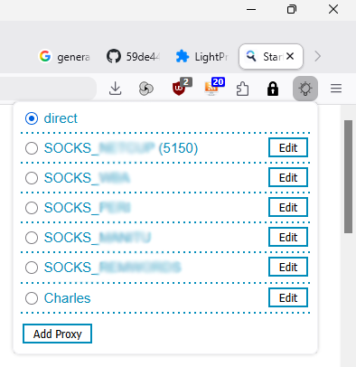

# LightProxy - Lightweight Proxy Switcher Add-on for Firefox

This repository is a backup archive for the final version 1.0.12 of addon [LightProxy](https://chrome-stats.com/d/lightproxy) by `Fmage Inc.`, a lightweight proxy management tool for Firefox. It provides a user-friendly interface for switching between HTTP, SOCKS4, SOCKS5, FTP, SSL and PAC scripts.

The add-on was removed from the Firefox Add-ons Store on 2023-10-14, maybe because the company behind it ceased to exist.

If you are looking for a lightweight add-on that allows to quickly switch between different (e.g. SOCKS5) proxies that you configured before, in my opinion LightProxy is still the best add-on available, which is why I still use it on a daily basis (by making use of an [AutoConfig hack](https://github.com/59de44955ebd/firefox-unsigned-addons)).

*LightProxy in Firefox 159 (Windows 11)*  
  
